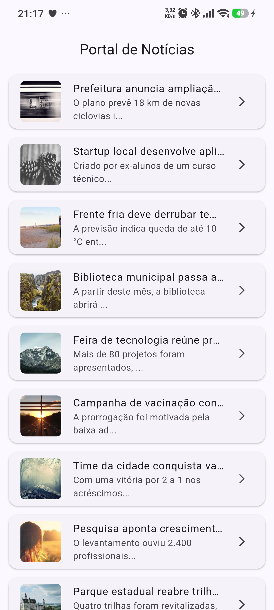
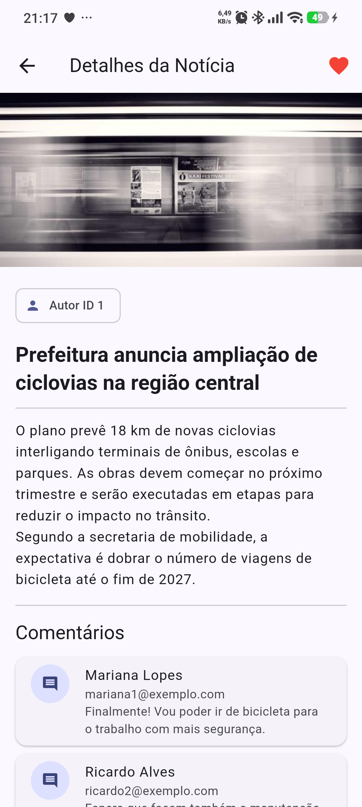
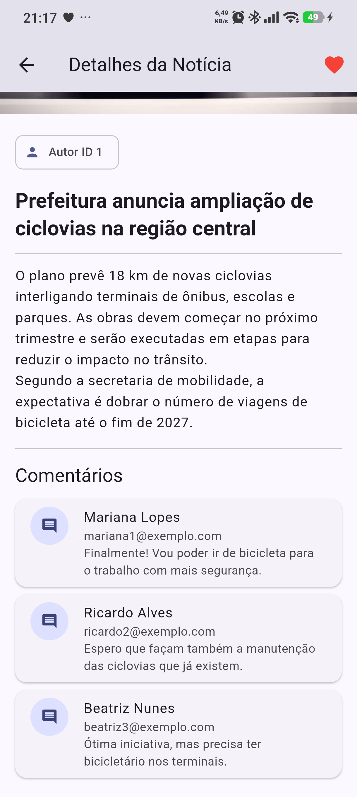
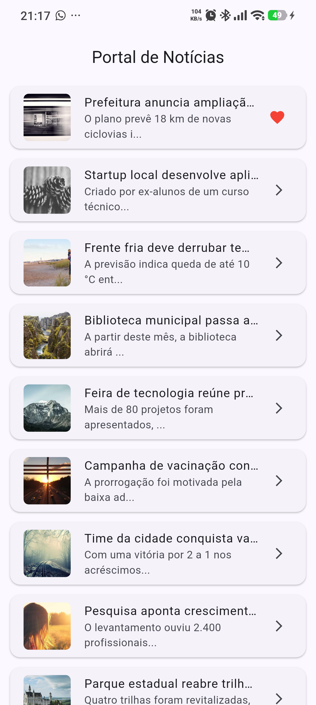

# PDM I — Aula 11: Navegação com API — Fluxo Lista/Detalhe (Master-Detail)

Aplicativo Flutter que carrega uma lista de notícias via API REST e, ao tocar em um item, navega para a tela de detalhes passando o objeto `NoticiaModel` pelo construtor — sem refazer a requisição de rede.

**Disciplina:** Programação para Dispositivos Móveis I — Prof. Diego Menegassi — 2026/2

## Conceitos aplicados

| Conceito | Implementação |
|---|---|
| Padrão Master-Detail | `ListView.builder` → `DetalheNoticiaScreen` |
| Passagem de objetos | `Navigator.push(context, MaterialPageRoute(...))` com `NoticiaModel` |
| Layout de detalhes | `SingleChildScrollView` + `Column` com imagem, autor, título e conteúdo |
| Otimização de rede | Reutilização do model já carregado na lista |

## Desafios implementados

- **Básico — Hero Animation:** imagem da lista e da tela de detalhes envolvidas em `Hero(tag: noticia.id)`.
- **Intermediário — Favoritar:** botão de coração na tela de detalhes; o estado retorna para a lista via `Navigator.pop(context, favorito)` e o item é marcado.
- **Avançado — Comentários:** a tela de detalhes faz uma segunda chamada à API e exibe os comentários da notícia.

## Capturas de tela

| Feed | Detalhes (favoritado) | Comentários | Feed com favorito |
|:---:|:---:|:---:|:---:|
|  |  |  |  |

## Estrutura

```
lib/
├── main.dart
├── models/
│   ├── noticia_model.dart
│   └── comentario_model.dart
├── services/noticia_service.dart
└── screens/
    ├── feed_noticias_screen.dart
    └── detalhe_noticia_screen.dart
api/
├── noticias.json        # lista de notícias
└── comentarios/{id}.json  # comentários de cada notícia
```

## Como executar

```bash
flutter pub get
flutter run
```
